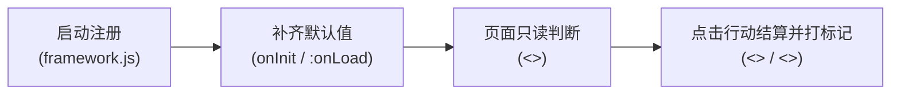

# 从示例到完整功能

写模组最容易踩坑的地方往往在接口衔接：人注册了却遇不到、奖励刷新页面能重复领、或者旧档读进来少字段。先跑通[快速开始](GettingStarted.md)，再对照这一页把功能串成闭环；需要完整文件时可同步打开 [NPC 公园约见实例](NamedNPC/Example.md)。



## 先理清玩家会经历什么

写代码前，先把状态流转画成一张表：例如“在公园认识露娜 → 约好有空再聊 → 赴约谈话加信任”。

| 当前状态 | 玩家行动           | 新状态 | 本次结算                   |
| :------- | :----------------- | :----- | :------------------------- |
| 尚未初遇 | 进入打招呼场景     | 已初遇 | 原版 `npc` 完成人物初始化  |
| 尚未约见 | 约好有空时聊聊     | 已约见 | 只改剧情状态，返回公园     |
| 已约见   | 赴约并完成初次交谈 | 已完成 | 信任增加 `5`，登记一条提示 |
| 已完成   | 再次交谈或重绘     | 已完成 | 保持原值，不再重复加点     |

## 划分文件与数据归属

| 文件或对象                      | 放什么内容                       | 生命周期                   |
| :------------------------------ | :------------------------------- | :------------------------- |
| `boot.json`                     | 依赖、脚本顺序、Twee 与资源路径  | ModLoader 加载模组时读取   |
| `framework.js`                  | NPC、数值、日程、事件、区域注册  | 每次启动游戏时执行         |
| `.twee` 中的 `[widget]` passage | 可复用界面与剧情 widget          | 注册后由页面或区域调用     |
| 普通 `.twee` passage            | 场景正文、选项、结算与出口       | 玩家进入该场景时渲染       |
| `setup.myMod`                   | 辅助函数、静态配置表             | 每次启动重建，不随存档保存 |
| `V.myMod` / `$myMod`            | 任务进度、已领取标记、模组设置   | 随当前存档保存             |
| `C.npc.Luna`                    | 当前存档中的人物关系与自定义数值 | 人物建表完成后读写         |

> [!TIP]
> 模组状态统一放进自己的 `V.myMod`，不要直接污染原版 `$daily` 或其他模组字段。`V.myMod` 在 JS 里读写，在 Twee 里对应 `$myMod`，二者是同一份存档对象。

## 注册与存档初始化分开

**注册**告诉框架“模组有什么内容”，每次启动都要执行；**存档初始化**负责补全 `V` 里的缺失字段，只在新档与读档时补默认值，绝不覆盖已有进度：

```javascript
function initMyMod(variables) {
  variables.myMod ??= {};
  variables.myMod.settings ??= {};
  variables.myMod.settings.enabled ??= true;
  variables.myMod.quest ??= {};
  variables.myMod.quest.rewardClaimed ??= false;
}

maplebirch.tool.onInit(() => {
  initMyMod(V);
});

maplebirch.on(':onLoad', save => {
  initMyMod(save.V);
});
```

> [!IMPORTANT]
> `:onLoad` 回调里必须操作 `save.V`（详见[存档与读档](Events.md#存档与读档)），此时全局 `V` 还是读档前的旧状态。另外 `??=` 只会补 `undefined` 或 `null`；涉及旧字段改名或类型修正时，请写在[迁移文件](Tools/Migration.md)中。

## 条件只读，行动再结算

游戏页面、侧边栏、社交卡片和 `cond` 回调可能会反复重绘与求值。**判断只读取状态，加点、发钱、推任务、打标记一律放进玩家点击后的行动里**：

```twine
<<if C.npc.Luna and !$myMod.quest.rewardClaimed>>
  <<link "领取任务的信任奖励" "My Mod Reward">>
    <<if C.npc.Luna and !$myMod.quest.rewardClaimed>>
      <<set C.npc.Luna.myModTrust to Math.clamp((C.npc.Luna.myModTrust ?? 0) + 5, 0, 100)>>
      <<set $myMod.quest.rewardClaimed to true>>
    <</if>>
  <</link>>
<</if>>
```

> [!CAUTION]
> 事件里的 `once: true` 只在**当前这次运行**里注销监听，不会持久化到存档；需要跨读档防重刷时，依然要用 `$myMod` 里的存档标记（例如上例中的 `$myMod.quest.rewardClaimed`）。

## 按需求选对接入方式

| 需求场景                 | 推荐入口                                                                     | 常见注意事项                                                 |
| :----------------------- | :--------------------------------------------------------------------------- | :----------------------------------------------------------- |
| 在选项页或页面区域加 UI  | [区域添加](Tools/Zones.md)                                                   | 准备好 widget 与显示条件即可                                 |
| 找不到现成区域插入口     | [源码补丁](Tools/Patches.md)                                                 | `expected` 数量对上不够，还要确认战斗/昏迷/营业时间限制没丢  |
| 随游戏时间推进结算       | [时间事件](Dynamic/TimeEvents.md)                                            | 考虑一次跳过数小时或跨天时的累计处理                         |
| 等到下个页面才弹出的剧情 | [状态事件](Dynamic/StateEvents.md)                                           | 写清触发条件、输出正文以及离开场景的出口                     |
| 新增人物与日常行踪       | [日程](NamedNPC/NamedNPCSchedule.md) / [侧边栏](NamedNPC/NamedNPCSidebar.md) | 日程只决定人物在哪，相遇剧情、立绘资源与在场判断仍需自己接好 |
| 食物、特质、转化等定义   | [数据注册](README.md#数据注册)                                               | 注册只管登记资料，具体玩法效果与成长点数要另写逻辑触发       |

## 按顺序自测与排错

新功能先在目标原版单独走一遍：**加载 → 首次触发 → 完成行动 → 重进页面 → 保存并读档 → 测老存档**，确认无误后再叠加其他要兼容的模组或分支。

| 检查阶段   | 预期现象                          | 异常时优先排查                                                          |
| :--------- | :-------------------------------- | :---------------------------------------------------------------------- |
| 加载       | 脚本只跑一次，widget/passage 存在 | ZIP 内路径、`boot.json`、是否重复加载脚本                               |
| 首次使用   | 默认值正常，初遇只初始化一次      | 注册顺序、存档初始化、原版 `npc` 调用                                   |
| 行动       | 只有成功点击行动才改变状态        | 点击回调、条件二次校验、防重复保护                                      |
| 重进页面   | 已完成的进度与数值保持不变        | 页面正文里是否误写了默认赋值                                            |
| 保存后读档 | 进度完整恢复                      | 是否用了 `save.V`、是否缓存了旧 NPC 对象                                |
| 较早存档   | 缺字段自动补齐，已有进度不丢      | `onInit` / `:onLoad` 与[迁移文件](Tools/Migration.md)                   |
| 分支兼容   | 原版前提仍成立，图片与文本正常    | 源码锚点、[模块与诊断](Modules.md)、[补丁报告](AddonPlugin.md#补丁报告) |

> [!NOTE]
> 专题页里的代码片段聚焦单个接口；如果里面出现了省略号或未定义变量，放进自己模组前记得补齐对应的人物、图片和出口 passage。完整可运行结构请直接对照 [NPC 公园约见实例](NamedNPC/Example.md)。

[返回文档导航](README.md)
