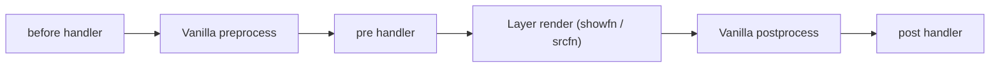

# Character Layers

## Purpose

Character layers extend the player sidebar model. Mods can add new layers, control visibility, provide face style images, or run pre/post render handlers.

Common uses:

- Add custom ears, eyes, tails, or accessory layers.
- Toggle layer visibility based on game variables.
- Add new styles or variants for character face styles.
- Prepare render options before drawing, or apply effects afterwards.



---

## Entry Points

```javascript
maplebirch.char.use(layerMap);
maplebirch.char.use(layerMap, target);
maplebirch.char.use(layerMap, target, { pet: true });
maplebirch.char.use('before', handler);
maplebirch.char.use('pre', handler);
maplebirch.char.use('post', handler);
maplebirch.char.use('pre', handler, target);
maplebirch.char.use('post', handler, target);
```

`use()` supports method chaining:

```javascript
maplebirch.char.use(layers).use('pre', preHandler);
```

By default, `use()` targets the vanilla `main` model only. Pass `target` when a mod needs to patch another canvas model.

`target` accepts three forms:

| Form                                | Purpose          |
| :---------------------------------- | :--------------- |
| `'main'`                            | One model        |
| `['main', 'clothes']`               | Multiple models  |
| `(name, modelOrOptions) => boolean` | Dynamic matching |

Common model names come from vanilla `Renderer.CanvasModels`, such as `main`, `lighting`, and `combatMainPc`.

> [!TIP]
> Omit `target` to patch only `main` and avoid unintended changes to other models. Use an array for a known list of models; use a predicate only for rule-based matching.

---

## Add a Layer

Minimal example:

```javascript
maplebirch.char.use({
  my_mod_glow: {
    srcfn: () => 'img/myMod/glow.png',
    showfn: options => V.myMod?.glow === true,
    zfn: () => maplebirch.char.ZIndices.hair
  }
});
```

Target a specific model:

```javascript
maplebirch.char.use(
  {
    my_mod_overlay: {
      srcfn: () => 'img/myMod/overlay.png',
      showfn: () => true
    }
  },
  'main'
);
```

Target multiple models:

```javascript
maplebirch.char.use(layers, ['main', 'lighting']);
```

Dynamic target:

```javascript
maplebirch.char.use(layers, name => name.startsWith('main'));
```

### Layer Fields

| Field                | Purpose         |
| :------------------- | :-------------- |
| `srcfn(options)`     | Image path      |
| `masksrcfn(options)` | Mask image path |
| `showfn(options)`    | Visibility      |
| `zfn(options)`       | Z index         |
| `filtersfn(options)` | Filters         |
| `animation`          | Animation key   |

`options` is the render parameter object passed by the vanilla model, containing character state, appearance options, and framework extension fields.

> [!IMPORTANT]
> `showfn` and `srcfn` run on every render; keep them read-only and never mutate `V` variables inside them. When `showfn` returns falsy, the framework automatically short-circuits `srcfn` to `''`.

---

## Pre/Post Handlers

### before

`before` runs before vanilla `preprocess`, suitable for adjusting base options before vanilla logic runs.

### pre

`pre` runs after vanilla `preprocess` and before layer rendering, suitable for preparing derived data or adjusting `options`.

```javascript
maplebirch.char.use('pre', options => {
  options.myMod ??= {};
  options.myMod.showAura = V.myMod?.aura === true;
});
```

Target specific models:

```javascript
maplebirch.char.use(
  'pre',
  (options, model) => {
    options.myMod ??= {};
    options.myMod.modelName = model?.name;
  },
  ['main', 'lighting']
);
```

### post

`post` runs after vanilla `postprocess`, suitable for post-render adjustments.

```javascript
maplebirch.char.use('post', options => {
  if (!options.myMod?.showAura) return;
  // Apply post-render effects here
});
```

The second handler argument is the active `CanvasModel` instance. Ignore it when only the render options are needed.

---

## Face Style Images

The framework scans `img/face/` inside every installed mod zip and adds discovered styles and variants to `setup.faceStyleOptions` / `setup.faceVariantOptions`, used by the vanilla mirror and the NPC sidebar Face Style / Face Demeanour options.

Recommended structure:

```text
img/face/
  cat/
    default/
      eyes.png
      mouth-happy.png
    sweet/
      eyes.png
```

NPC sidebar face layers render via `img/face/<facestyle>/<facevariant>/<layer>.png` (or `img/face/<facestyle>/<layer>.png`).

See [FaceStyle](./FaceStyle.md) for face image layout and `base-head.png` rules.

---

## Mask Helper

`maplebirch.char.mask()` generates a hair-gradient mask (returning a cached PNG data URL) with position and rotation controls:

```javascript
const mask = maplebirch.char.mask(0, 15);
```

Full signature: `maplebirch.char.mask(x = 0, rotation = 0, swap = false, width = 256, height = 256)`. Use it when implementing custom hair, gradients, or mask layers.

---

## Complete Example

```javascript
maplebirch.char.use('pre', options => {
  options.myMod ??= {};
  options.myMod.hasHalo = V.myMod?.halo === true;
});

maplebirch.char.use({
  my_mod_halo: {
    srcfn: () => 'img/myMod/halo.png',
    showfn: options => options.myMod?.hasHalo,
    zfn: () => maplebirch.char.ZIndices.hair,
    animation: 'idle'
  }
});
```

---

## Notes

- Prefix custom layer names with your mod name to avoid collisions with vanilla or other mods.
- Keep face style image paths consistent in casing.
- If you are only adding transformations, see [Transformations](Transformation.md) first.
