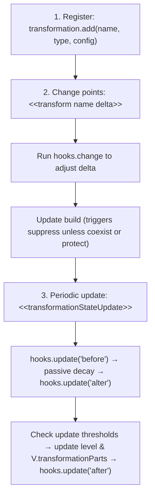

# Transformation System

## Overview

The transformation system lets a mod add custom body transformations (animal, divine, demonic, elemental, and so on), defining stages, traits, messages, and rendering layers.

```javascript
maplebirch.char.transformation.add(name, type, config);
```

Top-level `pre`, `post`, and `layers` target the vanilla PC `main` canvas. Supply the corresponding hooks in `combat` to register them to `combatMainPc`.



> [!IMPORTANT]
> Calling `maplebirch.char.transformation.add()` only registers definitions, parts, and layers — it does **not** grant transformation points or increase levels. In your story scenes, call `<<transform "dragon" 10>>` to change points, and let `<<transformationStateUpdate>>` evaluate thresholds and update `V.transformationParts`.

---

## Animal Transformation Coexistence

Mods can register runtime conditions that let native and framework-registered `physical` transformations grow together:

```javascript
maplebirch.char.transformation.coexistConditions.push(() => V.myMod?.hasCoexistTrait === true);
```

`coexist` is true when any condition returns `true`. Each update checks every animal form against its own growth thresholds, while skipping mutual suppression and natural decay. Explicit point losses and transformation removal still apply. Divine transformations are unaffected. With no active condition, the default rules apply. The familiar collar retains its existing behaviour.

---

## Compatibility Hooks

Register branch adapters through `tool.onInit()` before save restoration, using `maplebirch.char.transformation.hooks`. Registration configures rules; read game variables when the callbacks execute. These use the existing `Hooks` API: `add(name, callback, order)` and `remove(name)`. Callbacks must be synchronous.

| Hook     | Arguments and timing                                                                                        |
| :------- | :---------------------------------------------------------------------------------------------------------- |
| `change` | Before changing points, read `context.name` and adjust `context.change`                                     |
| `update` | `(stage, transformation)`: `before` decay, `alter` between decay and growth, `after` growth                 |
| `divine` | Adjust the native selection in `context.widget`, a `[macro, level]` tuple, or set it to `undefined` to skip |
| `setup`  | Merge or replace `context.transformations` on each initialization                                           |
| `clear`  | Add names to `valid.names` before stored state is cleaned up                                                |

```javascript
maplebirch.tool.onInit(() => {
  maplebirch.char.transformation.hooks.change.add('my-mod', context => {
    if (context.name === 'cat' && context.change > 0 && V.myMod?.growthBoost) context.change *= 2;
  });
});
```

Adapters can extend `animalTransforms`, `animalMacros`, `historyTransforms`, and the existing build, decay, and suppression tables. Any true condition in `protectConditions` prevents passive decay and mutual suppression. Explicit point loss still applies. Register adapters once and keep `setup` callbacks from adding duplicate entries.

---

## Rendering and Chimeras

`layers` and `combat.layers` accept a layer map or a function returning one. Layer maps register immediately. Functions run during the game's `StoryInit` phase, when native `Renderer.CanvasModels` are available. Transformations and chimera conditions can therefore register in `onInit` before image resources are ready.

```javascript
// Supply both images in the ZIP/imgFileList; adjust zfn for the artwork layering.
function dragonLayers() {
  return {
    myMod_dragon_tail: {
      srcfn: () => 'img/transformations/dragon/tail.png',
      showfn: () => isPartEnabled(V.transformationParts?.dragon?.tail ?? 'disabled'),
      zfn: () => 0
    }
  };
}

function dragonCombatPre(options) {
  options.myModDragonTail = isPartEnabled(V.transformationParts?.dragon?.tail ?? 'disabled');
}

const dragonCombatLayers = {
  myMod_dragon_combat_tail: {
    srcfn: () => 'img/transformations/dragon/combat-tail.png',
    showfn: options => options.myModDragonTail,
    zfn: () => 0
  }
};

maplebirch.tool.onInit(() => {
  maplebirch.char.transformation.add('dragon', 'physical', {
    build: 100,
    level: 6,
    update: [20, 40, 60, 80, 95, 100],
    parts: [
      {
        name: 'eyes',
        tfRequired: 2,
        label: 'Eyes'
      },
      {
        name: 'tail',
        tfRequired: 4,
        label: 'Scaled tail'
      }
    ],
    layers: () => dragonLayers(),
    combat: {
      pre: dragonCombatPre,
      layers: dragonCombatLayers
    },
    chimeras: [
      {
        name: 'demondragon',
        part: 'tail',
        sources: ['dragon', 'demon'],
        label: 'Demon dragon tail:'
      }
    ]
  });
});
```

- A part's optional `label` accepts a string or function and applies only to that transformation's mirror control.
- Each chimera specifies its `name`, `part`, contributing transformations in `sources`, and display `label`. The mirror shows its control when every source has that part visible.
- The framework adds native defaults and mirror controls. The toggle lives at `$chimera[name][part]`, defaults to `true`, and preserves a saved `false`. One chimera name can have several distinct parts.
- Select fusion images in the transformation's own `pre` and `layers`. Read the toggle with the native `isChimeraEnabled(name, part)`.

---

## Add a Custom Transformation

### Basic Structure

```javascript
// Register the transformation during mod initialization
maplebirch.tool.onInit(() => {
  maplebirch.char.transformation.add('dragon', 'physical', {
    // Required: transformation parts
    parts: [
      { name: 'horns', tfRequired: 1, default: 'default' },
      { name: 'tail', tfRequired: 2, default: 'default' },
      { name: 'wings', tfRequired: 3, default: 'default' },
      { name: 'scales', tfRequired: 4, default: 'default' },
      { name: 'claws', tfRequired: 5, default: 'default' },
      { name: 'fangs', tfRequired: 6, default: 'default' }
    ],

    // Optional: transformation traits
    traits: [
      { name: 'fire_breath', tfRequired: 4, default: 'default' },
      { name: 'dragon_sight', tfRequired: 3, default: 'default' }
    ],

    // Progression config
    build: 100, // Maximum build value
    level: 6, // Maximum level
    update: [20, 40, 60, 80, 95, 100], // Build thresholds for each level

    // Optional: icon
    icon: 'img/ui/dragon_icon.png',

    // Optional: level-up and level-down messages
    message: {
      EN: {
        up: [
          'Your back begins to itch...',
          'Scales start to form...',
          'Dragon wings burst forth...',
          'Your claws grow sharp...',
          'You feel draconic power...',
          'You have fully transformed into a dragon!'
        ],
        down: [
          'Your scales begin to shed...',
          'Your dragon wings wither...',
          'Your claws grow dull...',
          'Your draconic traits fade...',
          'You are almost human again...',
          'You have returned to human form.'
        ]
      }
    },

    // Optional: natural decay
    decay: true,

    // Optional: decay conditions
    decayConditions: [
      () => V.maplebirch.transformation.dragon.build >= 1,
      () => V.worn.neck.name !== 'dragon_amulet',
      () => playerNormalPregnancyType() !== 'dragon'
    ],

    // Optional: suppress other transformations
    suppress: true,

    // Optional: suppression conditions
    suppressConditions: [
      sourceName => sourceName !== 'dragon',
      () => V.worn.neck.name !== 'dragon_amulet'
    ],

    // Optional: pre-render hook
    pre: options => {
      if (V.maplebirch?.transformation?.dragon?.level >= 3) {
        options.scale_factor = 1.1;
        options.color_tint = '#d4a017';
      }
    },

    // Optional: post-render hook
    post: options => {
      if (V.maplebirch?.transformation?.dragon?.level >= 6) {
        // Refresh mod-owned render state here; do not mutate V transformation progress.
      }
    },

    // Optional: transformation layers
    layers: {
      dragon_horns: {
        srcfn: () => {
          const level = V.maplebirch?.transformation?.dragon?.level || 0;
          if (level < 1) return undefined;
          return `img/transformations/dragon/horns_${level}.png`;
        },
        showfn: () => isPartEnabled(V.transformationParts?.dragon?.horns ?? 'disabled'),
        zfn: () => maplebirch.char.ZIndices.effects
      },
      dragon_wings: {
        srcfn: () => {
          const level = V.maplebirch?.transformation?.dragon?.level || 0;
          if (level < 3) return undefined;
          return `img/transformations/dragon/wings_${level}.png`;
        },
        showfn: () => isPartEnabled(V.transformationParts?.dragon?.wings ?? 'disabled'),
        zfn: () => maplebirch.char.ZIndices.effects + 1
      }
    },

    // Optional: translations
    translations: {
      dragon: { EN: 'Dragon', CN: '龙' },
      fire_breath: { EN: 'Fire Breath', CN: '火焰吐息' },
      dragon_sight: { EN: 'Dragon Sight', CN: '龙之视觉' }
    }
  });
});
```

---

## Configuration Reference

### Required Parameters

| Field   | Type   | Description                                        |
| :------ | :----- | :------------------------------------------------- |
| `name`  | string | Unique transformation identifier                   |
| `type`  | string | Transformation type: `'physical'` or a custom type |
| `parts` | Array  | Array of transformation part definitions           |

### Parts and Traits

Each part or trait object contains:

- `name`: Unique identifier
- `tfRequired`: Minimum transformation level required to enable it
- `default`: Default value (optional, defaults to `'default'`)
- `label`: Mirror display label, string or function (optional)

```javascript
parts: [
  { name: 'tail', tfRequired: 2, default: 'default' },
  { name: 'horns', tfRequired: 1, default: 'curved' },
  { name: 'wings', tfRequired: 3, default: 'leathery' }
];
traits: [
  { name: 'night_vision', tfRequired: 2, default: 'default' },
  { name: 'enhanced_senses', tfRequired: 4, default: 'default' }
];
```

### Level Configuration

| Field    | Type     | Description                               |
| :------- | :------- | :---------------------------------------- |
| `build`  | number   | Maximum build value (defaults to `100`)   |
| `level`  | number   | Maximum level (typically `6`)             |
| `update` | number[] | Build thresholds for advancing each level |

```javascript
build: 100,
level: 6,
update: [20, 40, 60, 80, 95, 100] // Level 1 at 20 build, Level 2 at 40 build...
```

### Decay and Suppression

| Field                | Type       | Description                                                |
| :------------------- | :--------- | :--------------------------------------------------------- |
| `decay`              | boolean    | Whether natural decay is allowed (`true` for `'physical'`) |
| `decayConditions`    | Function[] | Array of decay condition predicates                        |
| `suppress`           | boolean    | Whether to suppress other forms (`true` for `'physical'`)  |
| `suppressConditions` | Function[] | Array of suppression condition predicates                  |

```javascript
decay: true,
decayConditions: [
  () => V.maplebirch.transformation.dragon.build >= 1,
  () => V.worn.neck.name !== 'dragon_amulet',
  () => !Weather.bloodMoon
],
suppress: true,
suppressConditions: [
  sourceName => sourceName !== 'dragon', // Do not suppress self
  () => V.worn.neck.name !== 'dragon_amulet'
]
```

### Messages

```javascript
message: {
  EN: {
    up: ['Level 1 message', 'Level 2 message', 'Level 3 message'],
    down: ['Level 1 to 0', 'Level 2 to 1', 'Level 3 to 2']
  },
  CN: {
    up: ['等级1消息', '等级2消息', '等级3消息'],
    down: ['等级1->0消息', '等级2->1消息', '等级3->2消息']
  }
}
```

Message keys are language codes. No message is output when the current language has no entry. `translations` provides bilingual display names for parts and traits; see [Translator](../Translator.md).

### Pre/Post Rendering Hooks

Top-level `pre` and `post` apply to `main`. Use them to adjust regular PC render options or add post-render effects. `combat.pre` and `combat.post` apply to the native combat PC model, `combatMainPc`.

```javascript
pre: options => {
  const level = V.maplebirch?.transformation?.dragon?.level || 0;
  if (level >= 4) {
    options.color_tint = '#ff6b00';
  }
},
post: options => {
  if (options.canvas) {
    setup.myMod?.drawAura?.(options.canvas);
  }
}
```

### Rendering Layers

Top-level `layers` register to `main`; `combat.layers` register to `combatMainPc` without a second manual registration. Use `maplebirch.char.use(layers, target)` for other models, with the actual name from `Renderer.CanvasModels`.

---

## Transformation State Storage

```javascript
V.maplebirch.transformation = {
  dragon: {
    level: 0, // Current level
    build: 0 // Current build value
  }
};

V.transformationParts = {
  dragon: {
    horns: 'disabled', // or 'default' or custom value
    tail: 'disabled',
    wings: 'disabled'
  },
  traits: {
    fire_breath: 'disabled',
    dragon_sight: 'disabled'
  }
};
```

---

## Complete Examples

### Example 1: Simple Fairy Transformation

```javascript
maplebirch.char.transformation.add('fairy', 'physical', {
  parts: [
    { name: 'wings', tfRequired: 1, default: 'delicate' },
    { name: 'glow', tfRequired: 2, default: 'default' },
    { name: 'pointed_ears', tfRequired: 3, default: 'default' }
  ],
  build: 100,
  level: 3,
  update: [33, 66, 100],
  decay: true,
  decayConditions: [
    () => V.maplebirch.transformation.fairy.build >= 1,
    () => !V.worn.earrings?.name?.includes('fairy')
  ],
  layers: {
    fairy_wings: {
      srcfn: () => 'img/transformations/fairy/wings.png',
      showfn: () => isPartEnabled(V.transformationParts?.fairy?.wings ?? 'disabled'),
      zfn: () => maplebirch.char.ZIndices.effects + 2
    }
  }
});
```

### Example 2: Elemental Transformation

```javascript
maplebirch.char.transformation.add('fire_elemental', 'elemental', {
  parts: [
    { name: 'aura', tfRequired: 1, default: 'flickering' },
    { name: 'embers', tfRequired: 2, default: 'default' },
    { name: 'flame_body', tfRequired: 4, default: 'default' },
    { name: 'fire_crown', tfRequired: 6, default: 'default' }
  ],
  traits: [
    { name: 'heat_aura', tfRequired: 3, default: 'default' },
    { name: 'fire_immunity', tfRequired: 5, default: 'default' }
  ],
  build: 100,
  level: 6,
  update: [20, 40, 60, 80, 95, 100],
  suppress: false, // Elemental form does not suppress other transformations

  pre: options => {
    const level = V.maplebirch?.transformation?.fire_elemental?.level || 0;
    if (level >= 2) {
      options.color_tint = '#ff3300';
      options.brightness = 1.1;
    }
    if (level >= 4) {
      options.heat_distortion = true;
    }
  }
});
```

---

## Shared Traits and Message Indices

> [!NOTE]
> `up[n - 1]` describes entering level n, and `down[n - 1]` describes leaving level n. Both arrays are ordered from the lowest level upward.

Traits with the same name, such as vanilla `sharpEyes`, remain enabled while any owning transformation meets its requirement. They disable only when all owners lose eligibility, without stacking vanilla bonuses. Registering a trait switch does not implement its skill or damage effect; the effect still needs vanilla or mod settlement logic.

> [!WARNING]
> Part visibility and trait switches are stored separately in `V.transformationParts`. Rendering should check `isPartEnabled()`, rather than the level alone, so parts hidden in the mirror stay hidden.
