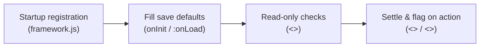

# From an example to a complete feature

Most mod bugs happen at the seams between APIs: a character is registered without an entry point, a reward can be claimed twice after reopening a page, or an older save is missing newly added fields. Start from [Getting started](GettingStarted.md) and keep the [NPC park-meeting example](NamedNPC/Example.md) handy if you want a full multi-file reference.



## Map the player's path first

Before picking APIs, trace the states a player walks through—for example, meeting Luna in the park, arranging to talk later, and gaining trust once the chat finishes:

| Current state  | Player action                            | New state  | Settlement                                |
| :------------- | :--------------------------------------- | :--------- | :---------------------------------------- |
| Not introduced | Enter the greeting scene                 | Introduced | Native `npc` initializes the character    |
| No arrangement | Agree to talk when free                  | Planned    | Update story state and return to the park |
| Planned        | Meet and complete the first conversation | Completed  | Add `5` trust and queue a notice          |
| Completed      | Talk again or redraw                     | Completed  | Keep existing values; never grant twice   |

## Give each file a clear job

| File or object                | What goes here                                    | Lifecycle                            |
| :---------------------------- | :------------------------------------------------ | :----------------------------------- |
| `boot.json`                   | Dependencies, script order, Twee & asset paths    | Read when ModLoader loads the mod    |
| `framework.js`                | NPC, stat, schedule, event, and zone registration | Runs on every game boot              |
| `[widget]` passage in `.twee` | Reusable UI and story widgets                     | Called by pages or zones after boot  |
| Regular `.twee` passage       | Scene prose, choices, settlement, and exits       | Rendered when the player enters      |
| `setup.myMod`                 | Helpers and static lookup tables                  | Rebuilt on boot; not saved           |
| `V.myMod` / `$myMod`          | Quest state, claimed flags, mod settings          | Persisted in each save               |
| `C.npc.Luna`                  | Relationships and custom stats in the active save | Read/written after NPC records exist |

> [!TIP]
> Keep your mod's state under `V.myMod` instead of mixing fields into vanilla `$daily` or other mods. `V.myMod` in JS and `$myMod` in Twee point to the exact same save object.

## Separate registration from saved defaults

**Registration** tells the framework what your mod provides on every boot. **Save initialization** fills missing fields in `V` without overwriting choices or progress already saved:

```javascript
function initMyMod(variables) {
  variables.myMod ??= {};
  variables.myMod.settings ??= {};
  variables.myMod.settings.enabled ??= true;
  variables.myMod.quest ??= {};
  variables.myMod.quest.rewardClaimed ??= false;
}

maplebirch.tool.onInit(() => {
  initMyMod(V);
});

maplebirch.on(':onLoad', save => {
  initMyMod(save.V);
});
```

> [!IMPORTANT]
> Inside `:onLoad`, always mutate `save.V` (see [Save and Load](Events.md#save-and-load)): global `V` still points to the pre-load state. Because `??=` only fills `undefined` or `null`, handle renames or type fixes in [migration files](Tools/Migration.md).

## Queries read; actions settle

Pages, sidebars, social cards, and `cond` callbacks redraw more often than you might expect. **Keep checks read-only, and put stat gains, money, quest steps, and flags inside the player's action**:

```twine
<<if C.npc.Luna and !$myMod.quest.rewardClaimed>>
  <<link "Claim the quest's trust reward" "My Mod Reward">>
    <<if C.npc.Luna and !$myMod.quest.rewardClaimed>>
      <<set C.npc.Luna.myModTrust to Math.clamp((C.npc.Luna.myModTrust ?? 0) + 5, 0, 100)>>
      <<set $myMod.quest.rewardClaimed to true>>
    <</if>>
  <</link>>
<</if>>
```

> [!CAUTION]
> An event's `once: true` option only unregisters it for the **current runtime**; use a flag in `$myMod` (such as `$myMod.quest.rewardClaimed` above) whenever progress must survive saving and loading.

## Pick the right integration point

| Goal                              | Use                                                                               | Watch out for                                                       |
| :-------------------------------- | :-------------------------------------------------------------------------------- | :------------------------------------------------------------------ |
| Add UI to Options or a page slot  | [Zones](Tools/Zones.md)                                                           | Supply the widget and display condition                             |
| No suitable zone exists           | [Source patches](Tools/Patches.md)                                                | A matching `expected` count isn't enough—preserve combat/hour gates |
| Update state as game time passes  | [Time events](Dynamic/TimeEvents.md)                                              | Handle large time jumps or multi-day skips cleanly                  |
| Queue a scene for the next page   | [State events](Dynamic/StateEvents.md)                                            | Provide condition, scene output, and a valid exit                   |
| Add an NPC and daily routine      | [Schedule](NamedNPC/NamedNPCSchedule.md) / [Sidebar](NamedNPC/NamedNPCSidebar.md) | Schedules place the NPC; you still write encounters & art           |
| Register food, traits, or TF data | [Data registration](README.md#data-registration)                                  | Registration stores metadata only; implement effects separately     |

## Verify and debug in order

Test on your target vanilla version first before stacking other mods or forks: **Load → First use → Action → Re-enter → Save & load → Older save**.

| Stage              | Expected result                          | Where to look first on failure                                                                |
| :----------------- | :--------------------------------------- | :-------------------------------------------------------------------------------------------- |
| Load               | Script runs once; widgets/passages exist | ZIP paths, `boot.json`, duplicate script loading                                              |
| First use          | Defaults present; intro runs once        | Registration order, `onInit`, native `npc` setup                                              |
| Action             | Only completed actions mutate state      | Click handler, inner guard, repeat-claim flag                                                 |
| Re-entry           | Progress and stats stay intact           | Page code accidentally resetting defaults                                                     |
| Save & load        | Saved progress returns cleanly           | Using `save.V`, stale cached NPC references                                                   |
| Earlier save       | New fields filled; old progress kept     | `onInit` / `:onLoad` and [migration files](Tools/Migration.md)                                |
| Fork compatibility | Native gates and assets still work       | Anchors, [Modules and diagnostics](Modules.md), [patch reports](AddonPlugin.md#patch-reports) |

> [!NOTE]
> Snippets in topic guides focus on a single API. Whenever a snippet uses ellipses or assumes existing characters/passages, fill those in or cross-check the complete [NPC park-meeting example](NamedNPC/Example.md).

[Back to documentation](README.md)
