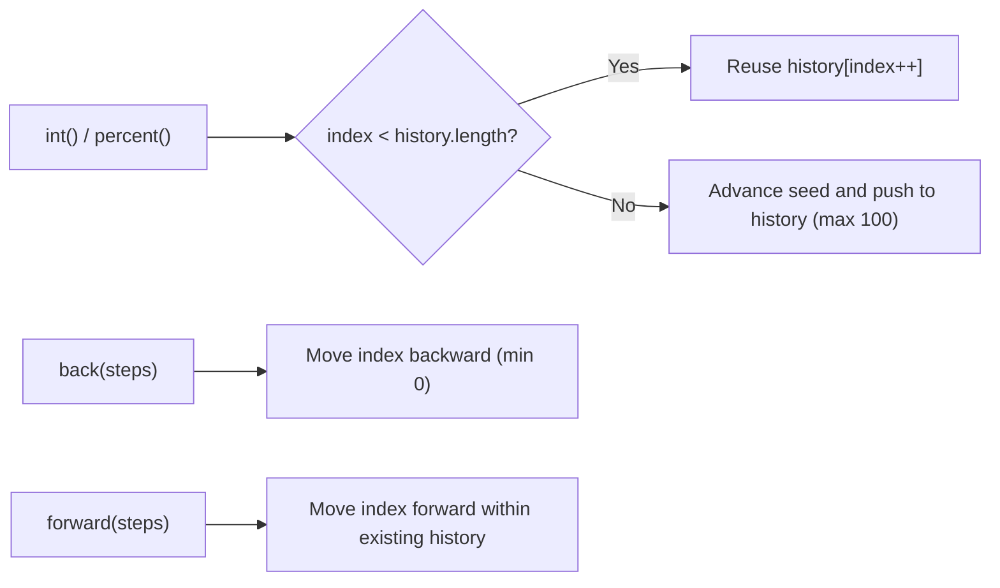

# Random system

## Purpose

`randSystem` creates reproducible random number generators. Use it when a mod needs saved seeds, repeatable results, replayable random events, backtracking, or easier debugging.

For one-off randomness, the [Utilities](../Utilities.md) helpers `random()` or `either()` may be enough. Use **`maplebirch.tool.rand.create()`** when the same state should produce the same sequence.

## Create A Generator

```javascript
const rng = maplebirch.tool.rand.create();
```

With save-backed state:

```javascript
V.myMod ??= {};
V.myMod.rand ??= {};

const rng = maplebirch.tool.rand.create(V.myMod.rand);
```

> [!TIP]
> `create(state)` uses the passed object directly as its internal state, so storing that object in `V` lets the random sequence save and restore with the game.

## Minimal Example

```javascript
const rng = maplebirch.tool.rand.create();

rng.seed = 12345;

const percent = rng.percent(); // 1-100
const index = rng.int(5); // 0-5
```

## API

| API                                   | Description                                       |
| :------------------------------------ | :------------------------------------------------ |
| `maplebirch.tool.rand.create(state?)` | Create a generator                                |
| `rng.seed`                            | Get or reset the seed                             |
| `rng.int(max)`                        | Generate an integer from `0` to `max`             |
| `rng.percent()`                       | Generate an integer from `1` to `100`             |
| `rng.back(steps?)`                    | Move the random history pointer backward          |
| `rng.forward(steps?)`                 | Move the pointer forward through existing history |
| `rng.history`                         | Copy of generated result history                  |
| `rng.index`                           | Current history pointer                           |

Each call to `int(max)` or `percent()` advances the random pointer.

## Reproducible Rolls

Setting `seed` clears history and restarts the sequence:

```javascript
const rng = maplebirch.tool.rand.create();

rng.seed = 42;

const a = rng.percent();
const b = rng.percent();
```

Using the same seed produces the same sequence:

```javascript
function roll(seed) {
  const rng = maplebirch.tool.rand.create();
  rng.seed = seed;
  return [rng.percent(), rng.percent(), rng.percent()];
}

roll(100); // same result every time
roll(100); // matches above
```

## Percentage Check

`percent()` returns `1-100`, suited for percentage checks.

```javascript
V.myMod ??= {};
V.myMod.rand ??= {};

const rng = maplebirch.tool.rand.create(V.myMod.rand);

if (rng.percent() <= 30) {
  setup.myMod.triggerRareEvent();
}
```

## Array Pick

`int(max)` returns an integer between `0` and `max` inclusive.

```javascript
const index = rng.int(4); // 0, 1, 2, 3, 4
const value = rng.int(100); // 0-100
```

Picking from an array:

```javascript
const list = ['a', 'b', 'c'];
const item = list[rng.int(list.length - 1)];
```

## Back And Forward



`back(steps)` only moves the history pointer. The next random call reuses a previously generated value:

```javascript
const first = rng.percent();
const second = rng.percent();

rng.back(1);

const again = rng.percent(); // same as second
```

`forward(steps)` only moves through already generated history. It does not create new random values.

```javascript
rng.back(2);
rng.forward(1);
```

> [!NOTE]
> Internal history keeps at most the last 100 entries; older entries are shifted out. Assigning `rng.seed = ...` clears history and resets `index` to `0`.

This is useful for debugging, stepping back through history, or recalculating the same roll in a flow.

## Save Data

Store the full state object when the sequence should belong to the save:

```javascript
V.myMod ??= {};
V.myMod.rand ??= {};

const rng = maplebirch.tool.rand.create(V.myMod.rand);
```

The state contains `seed`, `history`, and `index`. Saving only `seed` reproduces a sequence from the beginning; saving the full state restores the exact walked history.

## Example: Random Encounter

```javascript
function createEncounterRng() {
  V.myMod ??= {};
  V.myMod.encounterRand ??= {};

  return maplebirch.tool.rand.create(V.myMod.encounterRand);
}

function randomEncounter() {
  const rng = createEncounterRng();
  const roll = rng.percent();

  if (roll <= 20) return 'weakEnemy';
  if (roll <= 60) return 'normalEnemy';
  if (roll <= 85) return 'treasure';
  return 'specialEvent';
}
```

## Example: Fixed Loot Pool

```javascript
function generateLoot(seed) {
  const rng = maplebirch.tool.rand.create();
  rng.seed = seed;

  const types = ['weapon', 'armor', 'potion', 'ring'];
  const type = types[rng.int(types.length - 1)];
  const rarityRoll = rng.percent();

  let rarity = 'common';
  if (rarityRoll <= 5) rarity = 'legendary';
  else if (rarityRoll <= 20) rarity = 'rare';

  return {
    type,
    rarity,
    value: rng.int(100) + 1
  };
}
```
