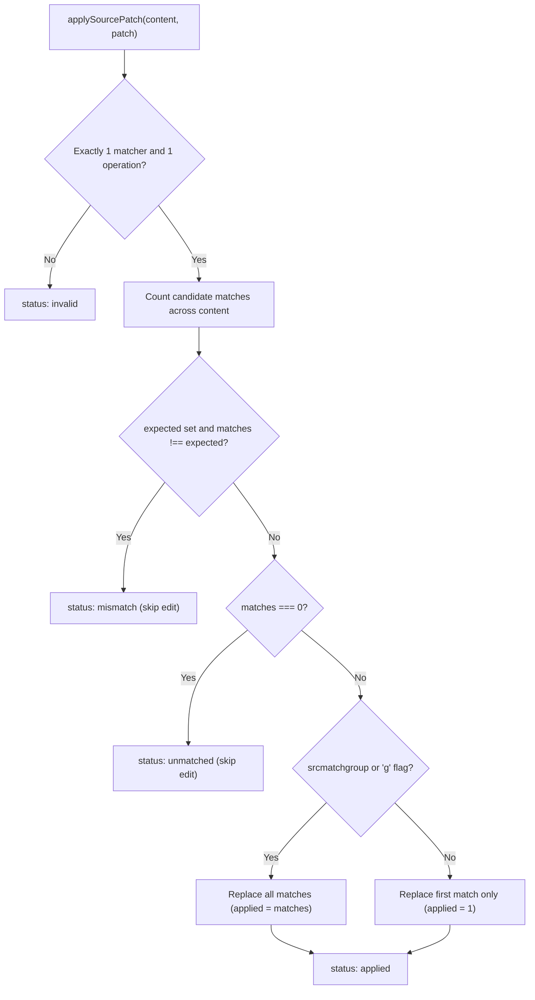

# Zones

> [!TIP]
> Prefer `maplebirch.tool.addTo()`. Consider [source patches](#source-patches) or [Patch Registration](Patches.md) only when a zone hook cannot achieve the result.

## Purpose

Zone manager adds widgets to existing game UI areas such as Options, StatusBar, menus, link zones, character panels, journal, and social pages.

If your goal is to place a widget into an existing UI slot, this is usually the right tool.

## Entry Point

```javascript
maplebirch.tool.addTo(zone, widget);
```

## Minimal Example

Define a SugarCube widget first:

```twine
<<widget "MyModOptions">>
  <h3>My Mod Options</h3>
  <<checkbox "$myMod.enabled" false true autocheck>> Enable feature
<</widget>>
```

Then add it to the Options zone:

```javascript
maplebirch.tool.addTo('Options', 'MyModOptions');
```

## boot.json

Fixed zone entries can be declared directly in `boot.json`:

```json
"framework": {
  "addto": "Options",
  "widget": "MyModOptions"
}
```

Multiple zones can be written as an array:

```json
"framework": [
  {
    "addto": "Options",
    "widget": "MyModOptions"
  },
  {
    "addto": "StatusBar",
    "widget": "MyModStatus"
  }
]
```

See [boot.json Configuration](../BootJson.md) for the full configuration schema.

## Widget Forms

### Widget Name

The most common form is a widget name string:

```javascript
maplebirch.tool.addTo('StatusBar', 'MyModStatus');
```

The framework renders it in the target zone as:

```twine
<<MyModStatus>>
```

### Function

You can pass a function directly:

```javascript
maplebirch.tool.addTo('Information', () => {
  return `Location: ${V.location}`;
});
```

Functions suit simple dynamic text; prefer SugarCube widgets for complex UI.

Functions may update state without returning content. Returning `undefined` or `null` produces no text in the zone.

### Conditional Config

Use a configuration object to control where the widget renders:

```javascript
maplebirch.tool.addTo('StatusBar', {
  widget: 'CombatStatus',
  passage: ['Combat', 'Struggle'],
  exclude: ['Victory']
});
```

Fields:

| Field     | Description                      |
| :-------- | :------------------------------- |
| `widget`  | Widget name                      |
| `passage` | Render only in matching passages |
| `exclude` | Skip matching passages           |
| `match`   | RegExp tested on passage title   |

## Link Zones

`BeforeLinkZone` and `AfterLinkZone` insert content before or after a group of links:

```javascript
maplebirch.tool.addTo('BeforeLinkZone', 'BeforeLinksHint');
maplebirch.tool.addTo('AfterLinkZone', 'AfterLinksHint');
```

`CustomLinkZone` inserts content at a specific link position:

```javascript
maplebirch.tool.addTo('CustomLinkZone', [0, 'BeforeFirstLink']);
maplebirch.tool.addTo('CustomLinkZone', [2, 'BeforeThirdLink']);
maplebirch.tool.addTo('CustomLinkZone', [-1, 'BeforeLastLink']);
maplebirch.tool.addTo('CustomLinkZone', [-2, 'BeforeSecondLastLink']);
```

Positions are zero-based. Negative positions count from the end: `-1` targets the last link and `-2` the second-last link. The second tuple item accepts a widget name or configuration object.

> [!NOTE]
> Only visible original `.macro-link` elements count, excluding links inserted into zones. Content is inserted before the target link; leading row icons such as `<<icon>>` or `<<getouticon>>` belong to the same link row, so the insertion point stays ahead of the icon instead of splitting it from its label (only when nothing but source whitespace separates the icon from the link; any text, `<br>` or element in between keeps the icon out of that row). Non-integer and out-of-range positions are skipped. Check the passage order before assuming its final link is an exit.

## Initialization

To run initialization functions around `StoryInit`:

```javascript
maplebirch.tool.onInit(() => {
  setup.myMod ??= {};
  setup.myMod.name = 'myMod';
});
```

Multiple functions can be passed together:

```javascript
maplebirch.tool.onInit(initData, initOptions, initWidgets);
```

When a string is passed, it is invoked as an `Init` zone widget:

```javascript
maplebirch.tool.onInit('MyModInitWidget');
```

## Source Patches

Use `maplebirch.tool.inject()` to change vanilla content or an internal execution branch. Put ordinary passages in `locationPassage` and widget-tagged passages in `widgetPassage`.

```javascript
maplebirch.tool.inject({
  locationPassage: {
    'MyMod Reward': [
      {
        src: '<<set $myMod.rewardClaimed to true>>',
        applyafter: '<<myModRewardSettled>>',
        expected: 1
      }
    ]
  }
});
```

> [!WARNING]
> This example uses Mod-owned names and state. Vanilla adapters must target a verified settlement point and place passages in the right group (`locationPassage` without `widget` tag, `widgetPassage` with `widget` tag), or the patch is skipped as `invalid`. Always set `expected` for vanilla patches.

| Field                        | Behavior                                                                     |
| ---------------------------- | ---------------------------------------------------------------------------- |
| `src`                        | Matches literal text and replaces the first occurrence                       |
| `srcmatch`                   | Regex replacement; `g` processes every match                                 |
| `srcmatchgroup`              | Processes all regex matches without re-scanning newly inserted content       |
| `to`                         | Replacement text, supporting JavaScript replace capture references           |
| `applybefore` / `applyafter` | Inserts literal text before/after each match                                 |
| `expected`                   | Optional expected match count; mismatch skips the patch and records mismatch |



Use one matcher and one operation per entry. `matches` counts candidates; `applied` counts replacements. A literal `src` found twice but replaced once reports 2 and 1 respectively. See [patch reports](../AddonPlugin.md#patch-reports) for missing targets and other failures.

## Common Zones

`zone` must use a name from the tables below. `passage`, `exclude`, and `match` all test against the passage title. `CustomLinkZone` uses a link index.

| Zone               | Position                 |
| :----------------- | :----------------------- |
| `Options`          | Options page             |
| `Cheats`           | Cheats page              |
| `Information`      | Options overlay info     |
| `Header`           | Passage header           |
| `Footer`           | Passage footer           |
| `StatusBar`        | Sidebar status           |
| `MenuBig`          | Big menu area            |
| `MenuSmall`        | Small menu area          |
| `BeforeLinkZone`   | Before link area         |
| `AfterLinkZone`    | After link area          |
| `CustomLinkZone`   | Specific link position   |
| `Journal`          | Journal extension        |
| `CharaDescription` | Character description    |
| `StatusSocial`     | Social custom status     |
| `NPCinit`          | NPC first-encounter init |
| `NPCinject`        | NPC spawn init           |

Character and stats zones:

| Zone                      | Position                     |
| :------------------------ | :--------------------------- |
| `CaptionDescription`      | Sidebar description          |
| `CaptionAfterDescription` | After sidebar description    |
| `HintMobile`              | Mobile hint area             |
| `MobileStats`             | Mobile stats area            |
| `DegreesBonusDisplay`     | Before degree bonus display  |
| `DegreesBox`              | Degrees box                  |
| `SkillsBonusDisplay`      | Before skill bonus display   |
| `SkillsBox`               | Skills box                   |
| `SubjectBoxBonusDisplay`  | Before subject bonus display |
| `SchoolSubjectsBox`       | School subjects box          |
| `SchoolMarksText`         | School marks text            |
| `WeaponBox`               | Weapon box                   |

Social page zones:

| Zone               | Position                 |
| :----------------- | :----------------------- |
| `ReputationModify` | Reputation modify area   |
| `Reputation`       | After reputation display |
| `FameModify`       | Fame modify area         |
| `Fame`             | After fame display       |

## Complete Example

```twine
<<widget "MyModStatus">>
  <<if $myMod.enabled>>
    <span class="gold">Mod Status: Enabled</span>
  <</if>>
<</widget>>

<<widget "MyModOptions">>
  <h3>My Mod</h3>
  <label><<checkbox "$myMod.enabled" false true autocheck>> Enable</label>
<</widget>>
```

```javascript
maplebirch.tool.onInit(() => {
  V.myMod ??= {};
  V.myMod.enabled ??= true;
});

maplebirch.tool.addTo('Options', 'MyModOptions');

maplebirch.tool.addTo('StatusBar', {
  widget: 'MyModStatus',
  exclude: ['Start']
});
```
